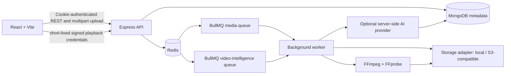

# Secure Intelligent Video Infrastructure

A TypeScript monorepo for secure video ingest, asynchronous processing, private adaptive playback and transcript-grounded video intelligence. Phases 1–6 implement authentication, resumable uploads, FFmpeg processing, HLS/DASH packaging, playback analytics, provider-backed transcription, subtitles, chapters, transcript search, evidence-cited Q&A and explainable playback review signals.

## Architecture



The browser never receives storage or AI credentials. Local upload parts stream to storage outside the frontend tree; S3-compatible uploads use short-lived checksum-bound part URLs. MongoDB persists processing and intelligence states as recoverable job records; workers reconcile queued/stale records after restarts. AI work starts after the video is processed and never blocks upload or playback. The worker stores validated transcript chunks and embeddings plus private WebVTT subtitles. Playback credentials are short-lived HMAC signatures bound to database-backed, revocable sessions. CDN signed delivery is not configured.

## Planned project structure

```text
apps/
  web/                 React UI, upload and playback experiences
  api/
    src/
      config/          validated server-side configuration
      middleware/      auth, validation, limits, request context, errors
      routes/          REST route registration
      controllers/     HTTP request/response orchestration
      services/        uploads, playback, analytics, AI workflows
      repositories/    persistence access
      models/          Mongoose schemas and indexes
      validators/      request and event schemas
  worker/
    src/
      jobs/            BullMQ processors and recovery
      media/           FFprobe, FFmpeg and packaging
      providers/       transcription and embedding adapters
packages/
  shared/              cross-app types and validation contracts
infra/
  compose/             local dependencies and deployment resources
docs/
  architecture.md      system boundaries, phases and risks
  api.md               REST contract (current and planned)
```

The current implementation includes web, API, worker and shared packages with authentication, metadata, uploads, media processing, API-proxied playback and transcript intelligence.

## Implementation phases

1. **Foundation:** workspaces, secure environment templates, UI shell, health/readiness API, worker bootstrap, Compose infrastructure, CI and initial tests.
2. **Identity and metadata:** cookie-based authentication, revocable sessions, User/Video models and owner-scoped metadata listing.
3. **Resumable ingest:** persisted upload sessions, local streaming and S3-compatible multipart adapters, checksum/size validation, owner checks, cleanup, upload/recovery UI and automated service tests.
4. **Media jobs:** idempotent BullMQ jobs, bounded retries/concurrency, FFprobe validation, resource-limited FFmpeg resolution ladder generation, private output storage and processing-status/retry APIs.
5. **Adaptive delivery and playback security:** HLS/DASH packaging, HLS.js/native playback, signed authorization for every manifest and segment, viewer watermark, configurable session limits/revocation, progress/resume, deduplicated events and analytics.
6. **Video intelligence:** pluggable transcription/subtitles, timestamped chapters/topics, authorized semantic and keyword search, transcript-grounded Q&A, explainable suspicious-pattern rules.
7. **Production readiness:** full-flow E2E tests, recovery/cleanup, operational deployment, threat-model review, measured benchmarks and reproducible demos.

## Risks and constraints

- **Large uploads:** the configured default maximum is 8 GiB, but that is a limit, not a verified capability claim. No end-to-end 8 GiB upload has been run. Verify bounded memory, interruption/resume and integrity using a real deployment and storage service before claiming support.
- **Private playback:** the API-proxy route checks short-lived credentials and a live database session on each private asset request. CDN/object-storage delivery is not configured or tested. Visible overlays and session limits deter sharing but cannot prevent screen capture; this project does not claim DRM or reliable forensic watermarking.
- **Resource abuse:** media processing applies file/duration/output/time/thread/concurrency limits; operators must size temporary storage and worker CPU/memory for their workload.
- **Device identity:** device fingerprints are imperfect signals. Concurrent-session and behavioral rules must be configurable and explainable, never treated as proof of piracy.
- **AI correctness and cost:** providers remain optional and server-configured. Missing credentials yield an explicit unavailable state; transcript-grounded answers cite evidence and abstain when evidence is insufficient. Real provider calls require credentials and can incur charges.
- **AI data flow:** configured runs send extracted audio and transcript passages server-to-server to OpenAI for transcription, chapter/topic extraction, embeddings and Q&A. Review provider retention and privacy terms before production use.
- **Search storage:** embeddings are ordinary MongoDB arrays and exact cosine similarity is computed over a bounded corpus (up to 50 owner videos and 200 chunks per video). No vector index is assumed. The UI labels actual vector mode and keyword fallback distinctly; the bounded scan is not intended for large corpora.
- **Transcription limits:** audio is compressed and capped at `AI_MAX_AUDIO_BYTES` (24 MiB default, 25 MiB maximum); longer audio may fail with a visible retryable error.
- **AI verification:** provider and worker tests use mocked responses. Real OpenAI calls, MongoDB/Redis job execution and FFmpeg transcription have not been verified.
- **Local vs production:** Compose MongoDB/Redis and future local media storage support development only. Production requires private object storage, secrets management, TLS, backups and monitored worker capacity.

## Prerequisites

- Node.js `>=22.12.0` and npm `>=10.9.0`
- Docker with Docker Compose
- FFmpeg and FFprobe on `PATH` (or configure `FFMPEG_PATH` and `FFPROBE_PATH`)

## Run locally

In PowerShell:

```powershell
Copy-Item .env.example .env
docker compose up -d
npm ci
npm run dev:api
```

In separate terminals:

```powershell
npm run dev:web
npm run dev:worker
```

Open `http://127.0.0.1:5173`, register an account and upload supported MP4, QuickTime or WebM files. Use `127.0.0.1` consistently for the web app and API: switching between `localhost` and `127.0.0.1` makes the browser treat the session-cookie request as cross-site. The upload UI supports selecting/dropping a file, pause/resume, retry, cancellation and refresh recovery. Processing states are polled while work is active, and failed jobs can be retried by their owner. Recovery metadata in localStorage is only a hint; the authenticated API is authoritative. MongoDB is needed for auth, uploads, processing state and the worker; Redis is needed to dispatch and execute processing jobs.

On Windows, install a trusted FFmpeg build and add its `bin` folder to `PATH`, or set absolute `FFMPEG_PATH` and `FFPROBE_PATH` values in `.env`. Verify both tools in a new PowerShell terminal:

```powershell
ffmpeg -version
ffprobe -version
```

Verify the workspace:

```powershell
npm run lint
npm run typecheck
npm test
npm run build
```

The API liveness endpoint is `http://127.0.0.1:4000/health`; readiness is `http://127.0.0.1:4000/ready`. Worker readiness is logged only after Redis, MongoDB and both BullMQ workers are ready.

### Optional video intelligence

Set `AI_OPENAI_API_KEY` in server-side `.env` to enable Whisper transcription, chat-based chapter/topic extraction and Q&A, and `text-embedding-3-small` embeddings. `AI_TEXT_MODEL`, `AI_EMBEDDING_MODEL`, `AI_MAX_AUDIO_BYTES`, `AI_TIMEOUT_MS` and `AI_PROCESSING_CONCURRENCY` are configurable. Leave the key empty to disable AI: processing reports `unavailable`, and search uses truthful keyword mode. Never expose the key through a `VITE_*` setting. AI is transcript-only; it does not watch or visually interpret video.

## Phase 2 authentication

The API provides:

- `POST /api/auth/register` — validates email, display name and password, creates a user with a bcrypt hash, and issues a session cookie.
- `POST /api/auth/login` — generic invalid-credentials response and a rate limit.
- `GET /api/auth/me` — safe current-user fields only.
- `POST /api/auth/logout` — revokes the active server-side session and clears the cookie.
- `GET /api/videos` — authenticated, owner-scoped metadata listing.

Sessions use random opaque credentials in `HttpOnly; SameSite=Lax` cookies. The database stores only a SHA-256 token hash, allowing server-side revocation and expiry. Production cookies use `Secure` and the `__Host-` prefix; state-changing auth requests must have the configured exact `WEB_ORIGIN`. Authentication requires MongoDB but does not require Redis. Rate limits use an in-process store, so multi-instance production deployments need a shared rate-limit store before scaling.

Passwords must be at least 12 characters and no more than 72 UTF-8 bytes (bcrypt's input limit); bcrypt cost is 12. Password hashes are excluded from normal model queries, the User schema rejects values that are not cost-12 bcrypt hashes, and hashes are never included in API responses. Production requires an HTTPS `WEB_ORIGIN` so Secure cookies can be used. Video storage keys are private model fields and are not returned by the listing endpoint.

The current auth/API tests use an in-memory repository and are not MongoDB integration tests. Run a real database verification after Docker is available with `docker compose up -d`, then exercise registration, login, `/me`, logout, and `/api/videos` against the API.

## Phase 3 resumable uploads

The local adapter stores data under `.local-media` at the repository root by default (override with `LOCAL_STORAGE_ROOT`). It streams each part to disk, hashes it and assembles the completed object as a stream. The API keeps no whole video in memory. Configure `MAX_UPLOAD_SIZE_BYTES` and `UPLOAD_PART_SIZE_BYTES` to fit the environment; the defaults are 8 GiB and 16 MiB. Sessions expire after `UPLOAD_SESSION_TTL_HOURS` (default 24), and a cleanup task removes expired session data and stale local parts.

For S3-compatible storage, set `STORAGE_PROVIDER=s3`, a private `S3_BUCKET`, `S3_REGION`, and optionally `S3_ENDPOINT` / `S3_FORCE_PATH_STYLE`. The AWS SDK uses its server-side credential provider chain (for example workload identity or `AWS_ACCESS_KEY_ID` and `AWS_SECRET_ACCESS_KEY`); do not put credentials in any `VITE_*` setting. Grant only the bucket multipart/list/head permissions needed by the API role. Configure bucket CORS for the exact web origin, browser `PUT`, and `x-amz-checksum-sha256`; configure a lifecycle rule to abort incomplete multipart uploads. Presigned part URLs expire after five minutes. These S3 behaviors have not been verified against a live S3-compatible service.

Supported upload API routes (all require the authenticated HttpOnly cookie and session ownership) are documented in [docs/api.md](./docs/api.md). The UI uses direct presigned part requests for S3 and streamed API part requests for local storage. Upload completion records verified original metadata and queues background processing; the upload request itself does not create renditions or manifests. Current automated upload tests use in-memory metadata repositories plus temporary local files; they are not MongoDB/S3 integration tests. The configured 8 GiB limit is not evidence that an 8 GiB end-to-end upload has been tested.

## Environment and secrets

`.env.example` contains local development values and placeholders only. `AUTH_SESSION_TTL_HOURS`, `AUTH_RATE_LIMIT_WINDOW_MS`, and `AUTH_RATE_LIMIT_MAX` configure auth sessions and per-process throttles. `PLAYBACK_SIGNING_SECRET` must be replaced with a strong random secret (at least 32 bytes) outside local development; `PLAYBACK_SESSION_TTL_MINUTES` bounds playback credentials. Keep `.env` untracked. Never expose storage or AI provider credentials through `VITE_*` variables.

## Phase 4 asynchronous processing

After upload verification, the Video document is atomically transitioned to `queued` with a processing attempt number. That MongoDB state is the durable outbox; BullMQ jobs use a deterministic video/attempt ID, retry with exponential backoff, and are reconciled by the worker after restart. A failed job can be retried by its owner via the API. Processing states are `queued`, `probing`, `transcoding`, `packaging`, `completed` and `failed`; upload success remains a separate state.

The worker downloads the private original to a temporary directory, probes the actual streams with FFprobe, then creates only configured heights supported by the source (default 1080/720/480/360/240). A source below 240p is encoded at its own source height, never upscaled. It verifies output probes and byte sizes before uploading versioned, private rendition keys; MongoDB is updated to completed only after all outputs are stored.

Important worker settings: `PROCESSING_CONCURRENCY`, `PROCESSING_THREADS`, `PROCESSING_TIMEOUT_MS`, `PROCESSING_MAX_DURATION_SECONDS`, `PROCESSING_MAX_OUTPUT_BYTES`, `PROCESSING_RESOLUTIONS`, `PROCESSING_TEMP_ROOT`, `FFMPEG_PATH` and `FFPROBE_PATH`. Output bytes are capped per source video; temporary disk must also fit the configured maximum source upload plus rendition outputs. Redis connection retries are bounded, and worker shutdown drains active jobs before closing resources.

Run tests with `npm test`. The real FFmpeg rendition integration test runs only when both `ffmpeg` and `ffprobe` are available; it is skipped otherwise. Unit tests use mocked MongoDB/storage boundaries. No MongoDB, Redis, S3-compatible, or full upload-to-processing integration test is claimed unless run against those services. The current environment does not have FFmpeg/FFprobe on PATH and Docker's Linux engine may be unavailable; verify actual runtime integrations before production use.

## Phase 5 adaptive streaming and playback

The worker packages each verified MP4 rendition into HLS media playlists and MPEG-TS segments, then writes a master playlist referencing only produced renditions. It also generates a static DASH MPD and validates all listed assets before saving streaming metadata. Streaming readiness is separate from upload completion and is set only after every output object is stored. HLS plays with HLS.js or a browser's native HLS implementation; the quality selector comes from actual HLS levels. DASH output is structurally checked, but player compatibility has not been certified.

Playback sessions are short-lived HMAC-SHA256 credentials bound to MongoDB sessions. Every manifest/segment fetch rechecks the credential, expiry, revocation, current visibility/access and persisted asset allowlist. HLS/DASH manifests are rewritten so child requests go through the same gate. Private S3 URLs and credentials never reach the browser. The implemented delivery mode proxies assets through the API; CDN signed cookies/URLs, edge caching and edge revocation are not configured.

`PLAYBACK_SIGNING_SECRET` must be a random value of at least 32 bytes and must be replaced for production. Sessions can be revoked and per-video concurrent limits (1–20) can be configured from the playback panel. The on-screen watermark contains only a session identifier and clock. It and session limits are deterrents, not DRM, forensic watermarking, or screen-capture prevention. Playback events are idempotent by session/event ID, watch positions are stored per user/video, and the dashboard summarizes received starts/completions/errors and session activity duration.

Playback service tests mock Mongoose. Real HLS/DASH package tests are conditional on FFmpeg and FFprobe; live MongoDB/storage and browser playback are separate verification requirements. Do not equate packaging success with verified end-to-end playback.
