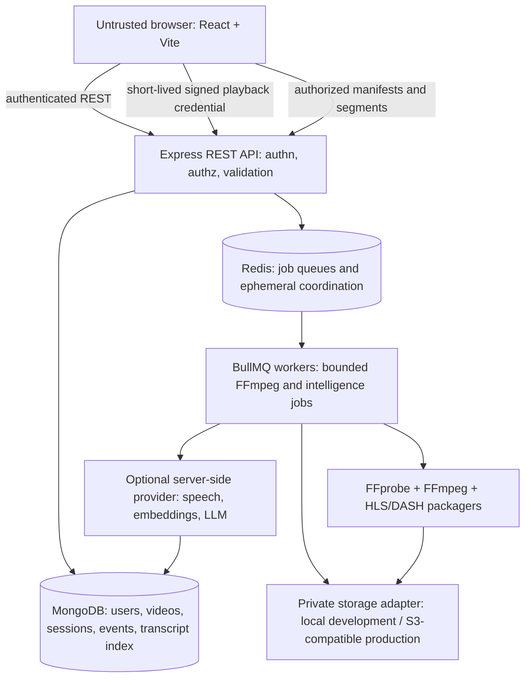

# Architecture and delivery plan

## Runtime boundaries



The API is the authorization boundary for private resources. The browser has no storage credentials. Future object keys are generated by the server, not derived from user filenames. Workers consume queue jobs and perform media/AI work outside request lifetimes. Metadata and media bytes have separate persistence responsibilities.

## Intended module layout

```text
apps/
  web/src/                 React routes, components, API client, playback
  api/src/
    config/                parsed environment and service wiring
    middleware/            authentication, authorization, validation, limits
    routes/ controllers/    HTTP interface
    services/               use cases and policy orchestration
    repositories/ models/   Mongo persistence and indexes
    validators/             external request and event schemas
    storage/                local and S3-compatible adapters
    playback/               signed authorization and asset access
  worker/src/
    jobs/                   BullMQ processors, retry policy and recovery
    media/                  probe, transcode, HLS/DASH packaging
    providers/              transcription, embeddings and LLM adapters
packages/
  shared/src/               runtime contracts and cross-app types
infra/
  compose/                   local service topology
docs/
```

This is the target organization. Phases 1–6 include foundation, identity/session/video metadata, resumable uploads, the FFmpeg processing pipeline, adaptive streaming delivery and transcript-based intelligence.

## Phase gates

1. **Foundation:** npm workspaces, strict TypeScript, env validation, UI shell, API health/readiness, worker queue connection, MongoDB/Redis Compose, CI and tests. Complete before implementing domain features.
2. **Identity and metadata:** cookie sessions, password hashing, revocation, request validation, auth rate limits, owner-scoped metadata listing and base User/Video models are implemented.
3. **Resumable ingest:** persisted sessions, ownership enforcement, server-generated object keys, bounded part sizes, checksums, retries, refresh recovery, completion validation, abandoned-upload cleanup and local/S3-compatible adapters are implemented. Tests use memory metadata repositories and temporary local storage. Verify interruption/resume against real infrastructure and large-file memory behavior; an 8 GiB end-to-end upload has not been tested.
4. **Processing:** upload completion atomically places the video in a durable MongoDB `queued` outbox state and increments a processing attempt. The API publishes a deterministic video/attempt BullMQ job; a worker reconciles queued documents to repair DB/Redis write gaps after restarts. BullMQ uses finite retries, exponential backoff and concurrency limits. The worker probes actual media, generates only no-upscale supported MP4 renditions, validates them and persists metadata only after outputs are stored. Owner-scoped status and retry routes are implemented. Redis/MongoDB and real FFmpeg integration still require live services for end-to-end verification.
5. **Streaming, access and analytics:** package and validate HLS/DASH outputs; complete processing only after persistence; proxy private assets through signed session checks; add HLS.js/native playback, visible watermark, concurrency settings/revocation, watch progress, deduplicated events and analytics. Source code is implemented; real FFmpeg packaging/player compatibility and live infrastructure remain verification gates.
6. **AI/search:** implemented with a separate durable BullMQ queue, optional OpenAI-compatible adapter, validated transcript/WebVTT, timed chapters/topics, owner-scoped exact-vector/keyword retrieval, transcript-evidence Q&A and playback review signals. Live provider and infrastructure verification remain deployment checks.
7. **Production and verification:** complete end-to-end flows, restore/recovery tests, deployment and operational runbooks, measured resource/performance results, threat-model checks and demo scripts.

## Security and integrity invariants

- Enforce authentication and resource ownership in API services for every private operation.
- Authentication uses short-lived opaque HttpOnly cookies, stores only a hash of each session token, checks revocation/expiry in MongoDB, and requires exact Origin checks for state-changing auth requests. Production requires HTTPS cookies.
- Keep secrets on the server and use least-privilege storage permissions with private buckets.
- Local uploads stream through the API to a private filesystem root. S3-compatible uploads use five-minute checksum-bound presigned part URLs; configure strict bucket CORS and abort-incomplete-multipart lifecycle cleanup. Storage credentials remain in the API's server-side credential chain.
- Processing jobs use the Video's persisted `processingStatus`/attempt as an outbox and BullMQ job IDs derived from those values. This avoids a distributed transaction between MongoDB and Redis; queued records are periodically reconciled. Stale active states are reset only after a configurable timeout. Failed outputs use attempt-versioned object keys, and incomplete files are removed from bounded temporary directories.
- FFmpeg/FFprobe are launched with argument arrays and no shell, per-command timeouts, bounded diagnostics, output byte limits, thread limits, and bounded worker concurrency. The source probe is authoritative for duration, dimensions and codec. The default resolution ladder is 1080/720/480/360/240 and filters out heights above the source.
- Validate file size, extension and detected format; never interpolate untrusted values into shell commands or filesystem paths.
- Bind all uploaded parts to a server-owned upload session and verify part and final-object integrity.
- Protect manifests and segments, not merely player initialization; expire and revoke playback sessions.
- Playback credentials are HMAC-SHA256 signed and bound to database sessions. Each asset request checks signature expiry, revocation, current visibility/ownership and a server-stored relative asset path. HLS/DASH references are rewritten to the same protected API endpoint.
- Per-video concurrency slots use a unique partial MongoDB index, so concurrent API instances cannot allocate the same active slot. Expired sessions are marked inactive before reusing slots. Event IDs are unique per session and payloads/rates are bounded.
- The API-proxy route is the only implemented delivery mode. It is not a CDN integration; do not cache private assets publicly or claim edge revocation/signed-cookie support.
- Treat transcript text as untrusted retrieved evidence, never as instructions. Include supporting timestamps and abstain when evidence is insufficient.
- AI processing runs only after successful video processing and uses persisted `transcription`/`chapterExtraction` states as its reconciliation source. Audio is extracted into a private temporary file, bounded to `AI_MAX_AUDIO_BYTES`, submitted server-to-server, and temporary files are removed. A missing provider key leaves intelligence explicitly unavailable; no synthetic transcript is created.
- Transcript chunks retain their video IDs and time ranges. Vectors are persisted in MongoDB arrays and exact cosine is computed only when all retrieved chunks have usable vectors; otherwise keyword mode is reported. The current exact scan is bounded to 50 recent owner videos and 200 chunks per video. It is not a configured MongoDB vector index and is not intended for large corpora.
- The OpenAI API key remains in API/worker environment variables. Provider audio/text processing has cost, retention and privacy implications; operators must review provider terms. Q&A receives only the selected video's retrieved transcript passages, treats them as untrusted text, validates returned citations, and abstains if evidence cannot be verified.
- Playback review signals are stored with time-window evidence and severity; they are heuristic review signals only and are not proof of wrongdoing.
- Do not describe visible overlays or browser restrictions as DRM; screen capture cannot be reliably prevented in a browser-only player.

## Operational risks and prerequisites

Node.js 22.12+, npm 10.9+, Docker Compose, FFmpeg and FFprobe are required for full local processing. Install FFmpeg on Windows and verify `ffmpeg -version` and `ffprobe -version`, or set `FFMPEG_PATH`/`FFPROBE_PATH`. Authentication/uploads/playback require MongoDB; processing requires MongoDB, Redis and FFmpeg/FFprobe. Playback also requires a strong `PLAYBACK_SIGNING_SECRET`. S3 mode additionally requires private object storage and server-side credentials. Large uploads, real player compatibility, CDN integration, resource sizing, queue recovery and AI cost/quality remain explicit verification gates. Local filesystem storage is not a production substitute for object storage.
