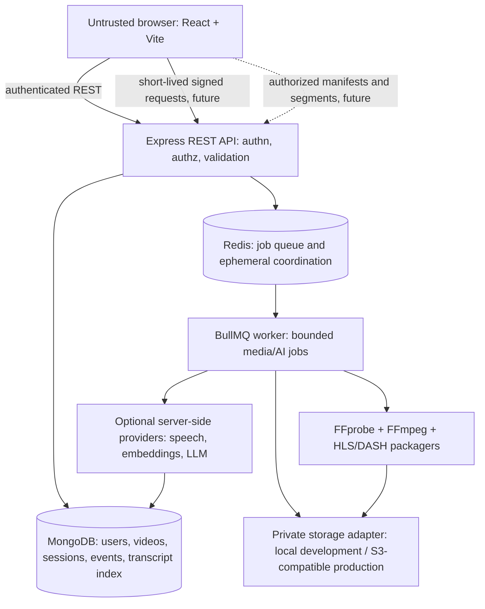

# Architecture and delivery plan

## Runtime boundaries



The API is the authorization boundary for private resources. The browser has no storage credentials. Future object keys are generated by the server, not derived from user filenames. Workers consume queue jobs and perform media/AI work outside request lifetimes. Metadata and media bytes have separate persistence responsibilities.

## Intended module layout

```text
apps/
  web/src/                 React routes, components, API client, playback
  api/src/
    config/                parsed environment and service wiring
    middleware/            authentication, authorization, validation, limits
    routes/ controllers/    HTTP interface
    services/               use cases and policy orchestration
    repositories/ models/   Mongo persistence and indexes
    validators/             external request and event schemas
    storage/                local and S3-compatible adapters
    playback/               signed authorization and asset access
  worker/src/
    jobs/                   BullMQ processors, retry policy and recovery
    media/                  probe, transcode, HLS/DASH packaging
    providers/              transcription, embeddings and LLM adapters
packages/
  shared/src/               runtime contracts and cross-app types
infra/
  compose/                   local service topology
docs/
```

This is the target organization; only Phase 1 components exist today.

## Phase gates

1. **Foundation:** npm workspaces, strict TypeScript, env validation, UI shell, API health/readiness, worker queue connection, MongoDB/Redis Compose, CI and tests. Complete before implementing domain features.
2. **Identity and resumable ingest:** authentication, authorization, upload-session ownership, safe generated keys, bounded part sizes, checksums, retries, resume state, final integrity, abandoned-upload cleanup and local/S3 adapters. Verify interruption and resume, including large-file memory behavior.
3. **Processing:** persist job/rendition state; use BullMQ retry/backoff, idempotency, concurrency caps and recovery. Probe actual media before choosing a no-upscale resolution ladder; bound FFmpeg time, threads, disk and memory.
4. **Streaming and access:** package real HLS/DASH assets, serve correct types, playback with HLS.js/native fallback, and check expiring/revocable authorization for every manifest and segment request. Test playback, expiry and unauthorized access.
5. **Viewer security and analytics:** safe viewer-specific overlay, configurable concurrent sessions/revocation, validated deduplicated playback events, session duration and per-user resume state. Fingerprints remain probabilistic.
6. **AI/search:** queued provider-backed transcript and WebVTT generation; timestamped transcript chunks/chapters/topics; authorized semantic retrieval and keyword fallback; evidence-linked Q&A with abstention; explainable heuristic alerts.
7. **Production and verification:** complete end-to-end flows, restore/recovery tests, deployment and operational runbooks, measured resource/performance results, threat-model checks and demo scripts.

## Security and integrity invariants

- Enforce authentication and resource ownership in API services for every private operation.
- Keep secrets on the server and use least-privilege storage permissions with private buckets.
- Validate file size, extension and detected format; never interpolate untrusted values into shell commands or filesystem paths.
- Bind all uploaded parts to a server-owned upload session and verify part and final-object integrity.
- Protect manifests and segments, not merely player initialization; expire and revoke playback sessions.
- Treat transcript text as untrusted retrieved evidence, never as instructions. Include supporting timestamps and abstain when evidence is insufficient.
- Do not describe visible overlays or browser restrictions as DRM; screen capture cannot be reliably prevented in a browser-only player.

## Operational risks and prerequisites

Node.js 22.12+, npm 10.9+, and Docker Compose are required for this foundation. Future phases additionally require an FFmpeg/FFprobe installation in the worker image, private S3-compatible storage, an authentication/secrets strategy, and optional provider credentials. Large uploads, media resource limits, segment-level authorization, queue recovery, and AI cost/quality are explicit verification gates. Local filesystem storage is not a production substitute for object storage.
